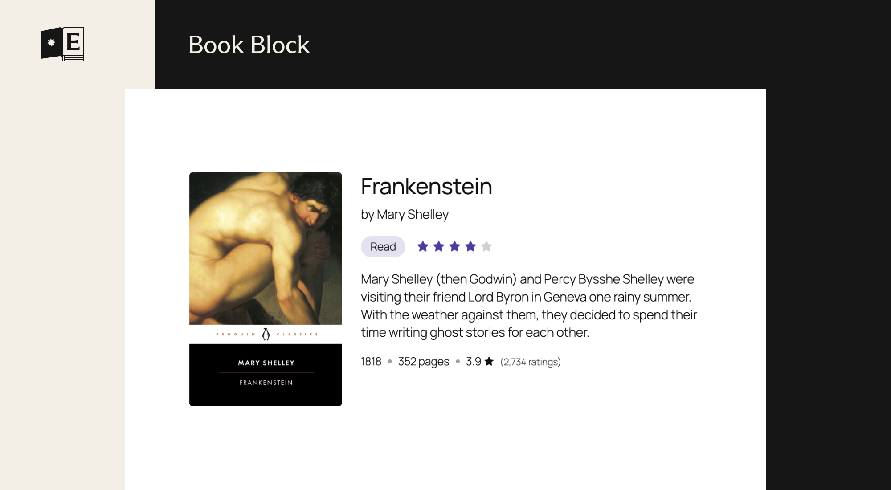
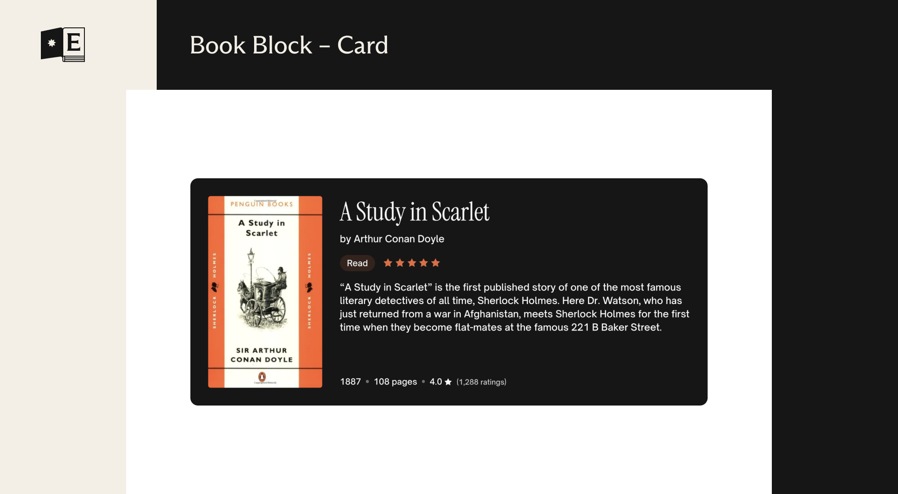
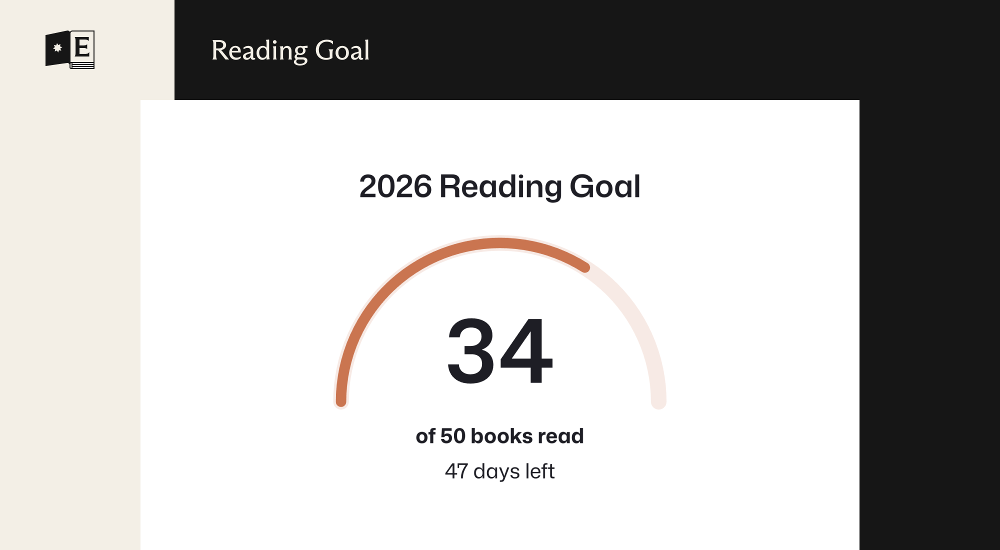
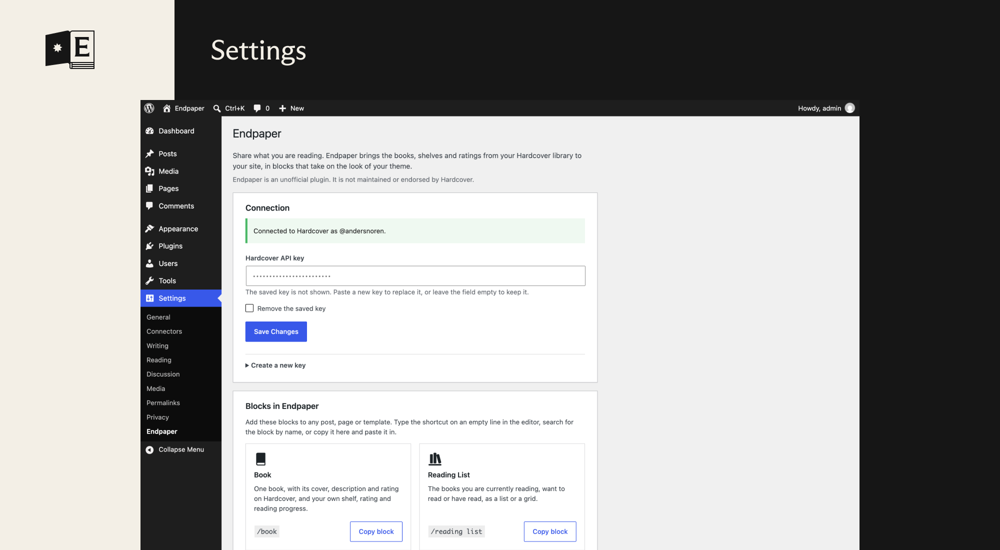
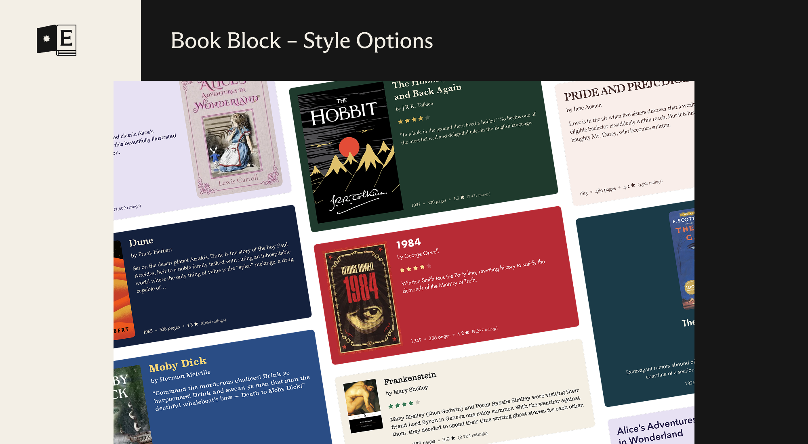

# Endpaper

[](https://github.com/andersnoren/endpaper/actions/workflows/ci.yml)
[](LICENSE)
[](https://wordpress.org/download/)
[](https://www.php.net/)


Book blocks for WordPress, powered by [Hardcover](https://hardcover.app).

Endpaper lets you show books from Hardcover in your posts and pages. Embed a single book with its cover, author, rating and description, show a list of the books you are reading from your own Hardcover library, or show how far along you are on a reading goal.

In a hardcover book, the endpapers are what attach the book block to the cover. This plugin does the same for WordPress blocks and Hardcover.

> [!NOTE]
> Endpaper is an unofficial plugin. It is created independently, using Hardcover’s public API, and is not maintained or endorsed by Hardcover. Please bring questions and requests about the plugin to this repository’s issues, not to Hardcover.

## The Book block



- Find a book by title, author or ISBN, or paste a link to its Hardcover page. A link on a line of its own in the editor becomes a Book block.
- Shows the cover, title, authors, description, year, page count and Hardcover rating. Optionally adds your shelf, your rating and your reading progress.
- Can show your own review in place of the description, with a link to it on Hardcover. A review marked as having spoilers stays closed until it is opened.
- Uses the cover Hardcover shows for the book, and you can pick the cover of any edition in the block settings.
- Cover size and position, text alignment, heading level, accent color and cover radius can all be changed. The Card style adds a light background, rounded corners and padding, and you choose the style new blocks start with under Settings, Endpaper.
- Follows the block’s font size and text color, and supports the color, typography, spacing, border and shadow settings in the editor.
- Can credit Hardcover with their logo, which is off until you switch it on.

## The Reading List block



- Shows books from your own library: the ones you are currently reading, have read or want to read. Ready-made variations for each are in the block inserter.
- A list or a grid of covers with up to six columns, and up to 20 books. Each book shows its cover, title, authors, your rating, the date you finished it and your progress, and each part can be switched off.
- Heading level, accent color and cover radius can be changed. Can credit Hardcover with their logo, which is off until you switch it on.
- Only books that are public on Hardcover are shown.

## The Reading Goal block



- Shows how far along you are on one of your public Hardcover reading goals, chosen in the block settings: the title, the count (books, pages or hours), the days left and, optionally, the percentage. A goal that is reached says so.
- Two styles: **Gauge**, a half circle with the count in the middle (the default), and **Bar**.
- The days left are worked out in the visitor’s browser, so the number is right on cached pages.
- Heading level and accent color can be changed. Can credit Hardcover with their logo, which is off until you switch it on.

## Shortcodes

For classic themes and places where blocks cannot go, such as a widget or a template, each block has a shortcode. They show the same thing as the blocks and only choose what to show. How it looks is up to the theme. Yes/no options take `yes`, `no`, `true`, `false`, `1` or `0`.

| Shortcode | Options |
| --- | --- |
| `[endpaper_book url="https://hardcover.app/books/the-stand"]` | `url` or `id` (the book), `cover`, `authors`, `meta`, `rating`, `my_rating`, `shelf`, `progress`, `description`, `review`, `credit`, `link` |
| `[endpaper_reading_list status="currently-reading" count="5"]` | `status` (`currently-reading`, `read` or `want-to-read`), `count`, `cover`, `authors`, `rating`, `date`, `progress`, `credit`, `link` |
| `[endpaper_reading_goal]` | `goal` (an ID; without it, the goal that is running now), `style` (`gauge` or `bar`), `title`, `days`, `percent`, `credit` |

The Book shortcode needs the address of a book on Hardcover. The first time an address is used, the book is looked up in the background, so it appears from the next page view. The Reading List and Reading Goal shortcodes show your own Hardcover account, so they need no address.

## Patterns

Two patterns are included, in the Endpaper category of the block inserter: **Currently reading**, a heading with the books you are reading now, and **Recently read**, a heading with the books you last finished. Both are lists of three.

## The settings screen



Under Settings, Endpaper:

- **Connection**: where you add your Hardcover API key, with a button that opens Hardcover’s form for a new key. It shows whether the key works, and which account it belongs to.
- **Blocks**: the blocks and patterns the plugin adds.
- **Appearance**: which style new Book blocks start with, Plain or Card.
- **Cache**: a button that clears everything fetched from Hardcover, covers included, so it is fetched again.

If Hardcover stops accepting the key, administrators get a notice in the admin, and Site Health reports it.

## For theme authors



Endpaper is made to be restyled. The blocks have very little styling of their own, take their fonts and colors from your theme, and are built on the standard color, typography, spacing, border and shadow settings, so most of the work can be done in `theme.json`, without a line of CSS or an override fighting the plugin. A theme can style them like any core block, under `styles.blocks` with `endpaper/book`, `endpaper/reading-list` and `endpaper/reading-goal`.

A few things `theme.json` has no setting for, such as the accent color and the opacity of muted text, are specific to Endpaper. A theme sets their defaults under `settings.custom`. This example lists all of them, with their default values except for the accent color:

```json
{
	"settings": {
		"custom": {
			"endpaper": {
				"accent": "var(--wp--preset--color--primary)",
				"coverRadius": "4px",
				"mutedText": 0.8,
				"mutedElement": 0.4,
				"hover": 0.75,
				"logoHover": 0.5,
				"accentFaded": 0.15,
				"columnMin": "10em"
			}
		}
	}
}
```

| Setting | Default | What it sets |
| --- | --- | --- |
| `accent` | From the palette | The accent color, used for the reading progress bar, the rating stars and the shelf label. Without it, the blocks pick one from the theme’s palette: the first of `accent`, `accent-1` to `accent-6` and `primary` that stands out from the background, with a contrast of at least 3:1. If none does, or the theme has no accent colors, they use the text color. |
| `coverRadius` | `4px` | The corner radius of book covers. |
| `mutedText` | `0.8` | The opacity of secondary text, such as the date of a review. |
| `mutedElement` | `0.4` | The opacity of small marks, such as the dots between facts and the line beside a quote. |
| `hover` | `0.75` | The opacity links and covers fade to under the pointer. |
| `logoHover` | `0.5` | The opacity the Hardcover logo fades to under the pointer. |
| `accentFaded` | `0.15` | How strong the accent color is as the background of the shelf label. |
| `columnMin` | `10em` | The narrowest a column in the Reading List grid gets. A narrow space gets fewer columns, down to one. |

To set any of them for one block only, put the same `custom` settings under `settings.blocks`:

```json
{
	"settings": {
		"blocks": {
			"endpaper/reading-list": {
				"custom": {
					"endpaper": {
						"accent": "#c2410c"
					}
				}
			}
		}
	}
}
```

The accent color and cover radius can also be changed for a single block in the editor, which takes precedence over the theme.

The big number in the middle of the Reading Goal gauge isn’t a heading, but it takes the font family, weight, style and letter spacing of the theme’s headings, from `styles.elements.heading.typography` in `theme.json` or the Styles screen. To give the number its own typography, set `elements.heading.typography` under `styles.blocks` for `endpaper/reading-goal`, which takes precedence.

The numbers in the facts row, the progress and the Reading Goal are set with lining numerals (`font-variant-numeric: lining-nums`), also in a font that has old-style numerals by default. A theme that wants old-style numerals can set `font-variant-numeric: normal` on `.endpaper-book__meta`, `.endpaper-book__review-meta`, `.endpaper-reading-goal__figures` and the like, in its own CSS.

The space between the items of a Reading List is the block’s gap. A theme sets it with `spacing.blockGap` under `styles.blocks` for `endpaper/reading-list`, and the Block spacing setting of a single block takes precedence.

## Book covers

Covers are downloaded from Hardcover once and shown from the site itself, so visitors’ browsers don’t contact Hardcover. They are saved in `wp-content/uploads/endpaper/covers`, not in the media library, in three widths (160, 320 and 640px, never larger than the original), as WebP where the server can write it and JPEG where it can’t. A cover that isn’t saved yet shows as a placeholder: it is saved in the background, usually within a minute. Covers no block has shown for a month are removed, and all of them when the cache is cleared or the plugin is deleted.

If the site can’t save files, covers are loaded from Hardcover instead, and Site Health says so.

Developers can change how covers are saved with filters, which are listed under [Hooks for developers](#hooks-for-developers).

## Hooks for developers

| Filter | What it does |
| --- | --- |
| `endpaper_cache_lifetime` | How long saved data from Hardcover counts as fresh, in seconds, never less than a minute. Receives the default and the kind: `book`, `edition` (a week each), `entry` (shelf, rating and progress), `list` or `goals` (an hour each). After that, visitors still get the saved copy while a new one is fetched in the background. |
| `endpaper_request_timeout` | How long a request to Hardcover may take before it is given up, in seconds. Default `15`, from 1 to 60. |
| `endpaper_search_results` | How many books a search in the editor shows. Default `7`, from 1 to 20. |
| `endpaper_backoff` | How long to wait after a failed request before asking Hardcover again, in seconds. Default `300`, at least 30. |
| `endpaper_cover_widths` | The widths covers are saved in, in pixels. Default `[ 160, 320, 640 ]`. |
| `endpaper_cover_quality` | The quality covers are saved with, from 1 to 100. Default `80`. |
| `endpaper_library_cover_source` | Which cover the Book and Reading List blocks show for a book in your library: `book` (default, the cover Hardcover shows for the book) or `edition` (the cover of the edition in your library). Clear the cache under Settings, Endpaper after changing it. |
| `endpaper_cover_max_bytes` | The largest cover, in bytes, that is downloaded from Hardcover. Default 15 MB. |
| `endpaper_import_covers` | Return `false` to load covers from Hardcover and save nothing. |
| `endpaper_allow_remote_covers` | Return `false` to never load a cover from Hardcover. A cover that can’t be saved is then a placeholder. |
| `endpaper_cover_hosts` | The hosts covers may be downloaded from. Default `[ 'assets.hardcover.app' ]`. |

Returning `false` from both `endpaper_import_covers` and `endpaper_allow_remote_covers` means no covers are shown at all. The edition picker in the editor always loads its thumbnails from Hardcover, in the browser of the person editing.

The cover format follows WordPress’s own `image_editor_output_format` filter, so a site that saves its images as AVIF gets AVIF covers.

### WP-CLI

| Command | What it does |
| --- | --- |
| `wp endpaper clear-cache` | Clears everything fetched from Hardcover, covers included, so that it is fetched again. The API key stays. It does nothing while the key is missing or turned down, as the books on the site would be gone until a key works again; `--force` clears it anyway. It is the same as the “Clear cache” button on the settings screen. |

## Performance

- **Visitors don’t wait for Hardcover.** Everything fetched from Hardcover is saved on your site, and a saved copy that has gone old is shown while a new one is fetched in the background. Something that isn’t saved yet is fetched in the background too, so that one visit shows nothing in its place instead of waiting. See “How it uses the Hardcover API” below.
- **Covers come from your own site.** They are saved in several sizes, the browser gets the one that fits, they load lazily, and they have a fixed size, so the page doesn’t jump when they arrive. Visitors’ browsers never contact Hardcover. See “Book covers” above.
- **Little code on the front end.** Each block’s styles are small and are only added to pages that use the block. The Book and Reading List blocks add no JavaScript for visitors. The Reading Goal block adds one small script, which keeps “days left” correct on pages that are served from a page cache. The editor code is only loaded in the editor.
- **Plays well with page caching.** The blocks are rendered on the server like any other block, so full-page caches work as usual. After the cache is cleared, a page may be cached once without a book that wasn’t saved yet, which saving the book in the editor normally prevents.

### Under the hood

Fetching is built to stay out of the way of both your visitors and Hardcover:

- **Stale while revalidate.** Each kind of data has a time it counts as fresh (a week for books, an hour for your shelf, lists and goals). Past that, the saved copy is still served at once, and a refresh is queued as a single WP-Cron event, `endpaper_refresh`, so the page never waits. Saved copies are kept for much longer than they count as fresh, so a page still has something to show if Hardcover is down. Change the times with the `endpaper_cache_lifetime` filter.
- **One shared backoff.** When a request fails, every block holds off for a few minutes (`endpaper_backoff`) instead of each page view trying again, so an outage or a rate limit isn’t made worse by your traffic.
- **Searching is guarded.** Searches in the editor are cached for an hour and limited to 20 a minute for each person, so a busy editor can’t use up the API key.
- **A rejected key is noticed.** If Hardcover turns the key down, visitors keep seeing what is saved, and Site Health and the settings screen tell the people who can fix it.

See [Hooks for developers](#hooks-for-developers) for the filters.

## Requirements

- WordPress 6.6 or later
- PHP 7.4 or later
- A [Hardcover](https://hardcover.app) account and an API key, which you can create in your Hardcover account settings

## Installation

Endpaper isn’t in the WordPress.org plugin directory yet, so for now it has to be installed from source.

1. Clone this repository into `wp-content/plugins/`:

	```sh
	git clone https://github.com/andersnoren/endpaper.git
	```

2. Build the block assets from the plugin folder:

	```sh
	npm install
	npm run build
	```

3. Activate Endpaper on the Plugins screen in WordPress.

4. Go to Settings, then Endpaper, and add your Hardcover API key. A button there opens Hardcover’s form for a new key with the right permissions already ticked.

To keep the key out of the database, define it in `wp-config.php` instead, above the line that says to stop editing. It then takes precedence over the settings screen:

```php
define( 'ENDPAPER_HARDCOVER_TOKEN', 'your-api-key' );
```

### Permissions for the API key

The button on the settings screen asks for these permissions and nothing else. A key cannot be changed after it is created, which is why the last one is included now, before there is a block that uses it.

| Permission | Used for |
| --- | --- |
| `read:catalog` | Looking up and searching for books. |
| `read:library:public` | Your reading lists, shelves and progress. Public entries only. |
| `read:me:content` | Your username, to confirm whose key it is. |
| `read:goals:public` | Your reading goals, for the Reading Goal block. |
| `read:lists:public` | Your lists, for a block to come. |

None of these let Endpaper change anything on Hardcover, or read anything you haven’t made public.

## How it uses the Hardcover API

- **Your API key is only sent to Hardcover.** All requests to Hardcover are made from PHP. The key is never sent to the browser, and the settings screen never shows a saved key. It is stored in the site’s database as it is, not encrypted, or you can define it as `ENDPAPER_HARDCOVER_TOKEN` in `wp-config.php` to keep it out of the database. Deleting the plugin removes the key and everything it has cached.
- **Requests are cached.** A book is fetched once and stored for a week, and a reading list is refreshed at most once an hour, so showing either doesn’t call Hardcover on every page view. When a saved copy gets old, visitors still get it at once and a new one is fetched in the background through WP-Cron, so nobody waits for Hardcover. The same goes for something that isn’t saved yet, such as the first view after the cache was cleared: that visitor sees nothing in its place, and the next one has it. (Without WP-Cron, the visitor waits instead.) Choosing a book in the editor saves it, so a new block is normally ready by the time the page is published. The update button in a block’s toolbar fetches that block’s data again at once: your shelf, rating, progress and review, a reading list or the goals. Each person can use it once every ten seconds. Search requests are only made while you are searching in the editor, are cached for an hour, and are limited to 20 a minute for each person.
- **It keeps working if Hardcover can’t be reached.** If a request fails, the block shows the last copy it has.
- **Cover images are saved on your site.** Each cover is downloaded from Hardcover once and shown from your own site after that. See “Book covers” above.

## Development

The build and lint tools need Node 22.22 or newer (`.nvmrc` has the major version, so `nvm use` picks it). Install the tools once:

```sh
npm install
composer install
```

| Command | What it does |
|---|---|
| `npm run build` | Builds the blocks from `src/` into `build/` |
| `npm start` | Rebuilds on every change |
| `npm run lint:js` | Checks the JavaScript |
| `npm run lint:css` | Checks the styles |
| `npm run format` | Fixes JavaScript formatting |
| `composer run phpcs` | Checks the PHP against the WordPress coding standards |
| `composer run phpcbf` | Fixes the PHP issues that can be fixed automatically |

### Tests

`tests/smoke.php` loads the plugin in a real WordPress and goes through its main paths: the blocks, the caching and background fetches, the covers, the settings screen and the editor routes. Hardcover is never contacted, its answers are faked in the test. Any PHP notice, warning or deprecation counts as a failure, so it is also a good way to check the oldest PHP version the plugin supports.

Run it with WP-CLI, with the plugin active:

```sh
wp eval-file wp-content/plugins/endpaper/tests/smoke.php
```

If you use [WordPress Studio](https://wordpress.studio/), run it with `studio wp` in place of `wp`. Use a site made for testing: the test removes the plugin’s API key and its cache.

The code is organized like this:

- `endpaper.php` is the main plugin file.
- `includes/` holds the Hardcover API client, caching and the REST route the editor uses.
- `src/blocks/` holds the source of each block.
- `build/` is generated by `npm run build` and isn’t part of the repository.

## License

Endpaper is free software, released under the [GNU General Public License, version 2 or later](https://www.gnu.org/licenses/gpl-2.0.html).
